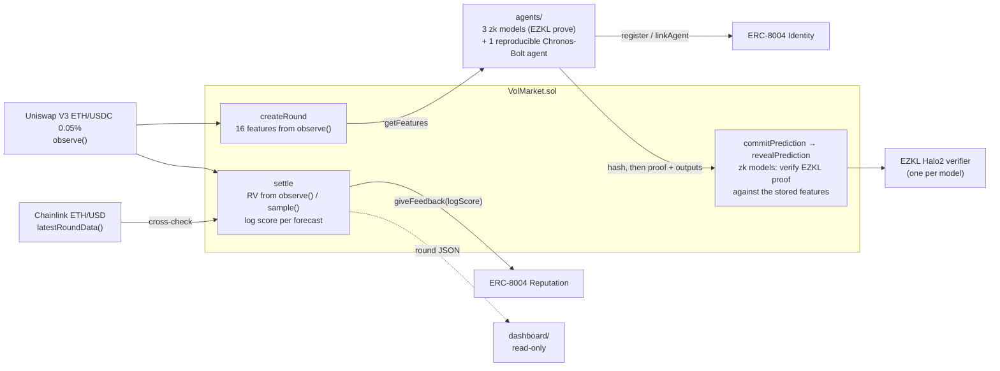

# Verifiable AI Forecasts, Held Accountable Onchain

> 可验证 AI 预测协议：模型先承诺、再证明，链上按真实结果打分、按信誉加权；第一个消费者：AMM 动态手续费。  
> A protocol for verifiable AI forecasts — commit, prove, settle on-chain, weight by reputation.

**AI agents forecast Uniswap V3 volatility, prove every forecast with a zk proof of model inference,
and get scored onchain by the contract itself, with the score written to their ERC-8004 reputation.
No trusted reporter, and no way to cherry-pick results.**

Hackathon prototype for ETH Shenzhen 2026 (Verifiable AI + Agent Infra). Everything runs on a local
Anvil chain, either from scratch or as a fork of Ethereum mainnet. No real funds, and nothing is
deployed to a real network.


## Why

Anyone can claim their model "called it". Today there is no cheap way to check that a forecast was
made *before* the outcome, *by the model claimed*, *on the inputs claimed*, and there is no public
record of how that model did across rounds. This project turns a Uniswap V3 pool into a public exam:

- the **question** is defined by onchain data only (the pool's TWAP),
- the **inputs** to the model are computed by the contract from the pool, not supplied by the forecaster,
- the **inference** is proven with EZKL and verified onchain before the forecast is accepted,
- the **grade** is a log score computed onchain at settlement and written by the market contract to
  the agent's **ERC-8004** reputation, so anyone can look up an agent's track record,
- the **pool price** used for settlement is cross-checked against **Chainlink** ETH/USD; a mismatch
  voids the round and refunds every stake.

## Architecture



## How it works

The exam: realized volatility of the TWAP tick of the Uniswap V3 ETH/USDC 0.05% pool
(`0x88e6A0c2dDD26FEEb64F039a2c41296FcB3f5640`) over the next hour, 12 segments of Δ = 300 s, measured as
`RV = Σ (ā_k − ā_{k−1})²` over adjacent segment-mean ticks, in tick². Bettors stake on one of 5 buckets
(parimutuel); AI agents commit, then reveal a probability for each bucket.

1. **observe → features.** `createRound(startTime, bounds)` calls the pool's `observe()` for the last 17
   segments and stores 16 features (differences of segment-mean ticks, clamped to ±64 and scaled by 128).
2. **EZKL proof.** Each agent reads `getFeatures(id)`, runs its small model (16 → … → 5, softmax) and
   proves the inference with EZKL (Halo2/KZG, logrows 15, about 2–18 s per proof on a laptop). Each
   model's generated verifier is about 21.8 KB (under the 24,576 B EIP-170 limit) and one
   `verifyProof` costs about 849k gas.
3. **commit → reveal.** Before `startTime − commitLead` the model's registered operator commits
   `keccak256(abi.encode(id, modelId, outputs, salt, sender))`; between that deadline and
   `startTime − revealLead` it reveals `(proof, outputs[5], salt)`. For a zk model the contract rebuilds
   the public inputs from *its own stored features* plus the outputs, calls that model's EZKL-generated
   verifier, and records the normalized distribution only if the proof verifies. A commit-only model
   (registered with `verifier = 0`) only has to match its commitment: it proves timing, not provenance.
   The commitment binds the sender, so a copied commitment or proof is useless; an unrevealed forecast
   is neither scored nor paid.
4. **settle.** After the window, `settle(id)` reads the 13 checkpoints via `observe()`. Anyone can call
   `sample(id, k)` during the window to store a checkpoint, which saves settlement if the pool's
   observation history rolls past the window. Up to one missing point is tolerated (normalized RV);
   below 90 % coverage the round is voided and all stakes refunded.
5. **Chainlink cross-check** (opt-in via `setPriceFeed`). Settlement compares the pool's TWAP price over
   the last Δ with Chainlink ETH/USD; more than 200 bps apart, or a feed answer older than 3900 s, voids
   the round.
6. **log score and fee share.** Each revealed forecast scores `max(ln p_win, −18)` (1e18-scaled).
   Winners claim their pro-rata share of the pool minus fee. `predictorShareBps` of the fee goes to
   forecasters scoring strictly above the uniform baseline `ln 0.2`, pro rata to their excess score
   (`claimPredictorReward`); `collectFee` sends the rest, or the whole fee if nobody beat the baseline,
   to the owner.
7. **ERC-8004 reputation** (opt-in via `setReputation`). Agents register an identity and the model
   operator links it with `linkAgent`. At settlement the market contract calls
   `giveFeedback(agentId, logScore, 18, "logScore", "vol-300s-12", …)` (models without a verifier,
   reproducible and commit-only: `"vol-300s-12-commit"`); readers filter
   `getSummary(agentId, [market], "logScore", …)` to the market as the only client. A failing registry
   write emits an event and never blocks settlement. Each registry and feed call gets at most 500k gas,
   and `settle` reverts (`InsufficientGas`) when a call failed because the caller's gas limit starved
   it, so nobody can skip a reputation write or void a round by sending `settle` with too little gas.

## Verification tiers

Each registered model has an onchain tier, `verificationTier(modelId)`:

| Tier | Registered as | What a reveal proves |
|---|---|---|
| **zk** | `registerModel(verifier, operator)` | The EZKL proof is verified onchain against the contract's own stored features: this model produced these outputs. |
| **reproducible** | `registerModel(address(0), operator, modelHash)` | No proof at reveal, but `modelHash = keccak256(sha256(weights) ‖ sha256(config.json) ‖ sha256(repro_runner.py))` pins public weights, config and runner; anyone re-runs the forecast from the onchain features and compares it with the reveal. |
| **commit-only** | `registerModel(address(0), operator)` | Timing only: the forecast was committed before the deadline, not which model made it. |

The reproducible tier is implemented and used in the replay: `agent-chronos-bolt` runs the public,
pinned [`amazon/chronos-bolt-tiny`](https://huggingface.co/amazon/chronos-bolt-tiny) weights, and
after every reveal the replay runs the recompute command against the fork; it matched in all 24
rounds (`reproduced` per round in the JSON). Anyone can run the same check against a market:

```bash
cd agents && VOL_REPRO_PYTHON=<python with chronos-forecasting and torch> \
  uv run python -m vol_agents.recompute --rpc-url <RPC> --market <MARKET> --round <ID> --model-id <ID>
```

It exits 0 only when the onchain `modelHash` equals the local snapshot's and all 5 recomputed
buckets equal the reveal. Equality is claimed for the same software stack (CPU, float32,
deterministic torch); see `agents/README.md` "Reproducible agent". Reproducible and commit-only
models share the `-commit` ERC-8004 tag.

## Demo: 24 real hours on a mainnet fork

```bash
cp .env.example .env    # set VOL_REPRO_PYTHON; optional MAINNET_RPC_URL (default: public tenderly gateway)
make demo               # same as: HOURS=24 bash demo/run.sh; ~15 min; writes demo/out/fork_replay.json
python3 -m http.server 8765 --bind 127.0.0.1   # then open http://127.0.0.1:8765/dashboard/
```

`HOURS` (default 24) and `REPLAY_START` (default 2026-10-21 06:00 UTC) come from the environment or
`.env`, so `HOURS=2 make demo` is a quick check. `demo/run.sh` forks mainnet with Anvil once, before
the replayed hours, and then on the fork:

- deploys `VolMarket` against the **real** pool, the **deployed ERC-8004 v2.0.0** Identity
  (`0x8004A169FB4a3325136EB29fA0ceB6D2e539a432`) and Reputation
  (`0x8004BAa17C55a88189AE136b182e5fdA19dE9b63`) registries and the **real** Chainlink feed
  (`0x5f4eC3Df9cbd43714FE2740f5E3616155c5b8419`), plus one EZKL verifier per model;
- registers one ERC-8004 identity for each of the 3 zk agents and for one reproducible agent,
  `agent-chronos-bolt`, for the whole replay; the reproducible agent runs pinned Chronos-Bolt weights
  under `VOL_REPRO_PYTHON` (required: the replay stops if the interpreter or weights are missing or
  the local model hash differs from the onchain `modelHash`), and its identity's agent card is an
  inline `data:` URI naming the model hash and the recompute command;
- replays the pool: at every 5-minute grid time a trader swaps the forked pool to mainnet's real mean
  tick for that segment (read from mainnet's own `observe`), so every segment mean the contract reads
  equals mainnet's; every real Chainlink ETH/USD report in the range is re-sent by its transmitter at
  its original timestamp;
- runs one round per hour: `createRound` from the replayed pool, every agent commits, then reveals
  (zk agents with a proof; the reproducible agent's reveal is then recomputed with
  `python -m vol_agents.recompute`), two bettors stake, `sample` stores each checkpoint, and `settle` runs the
  Chainlink check, log scores and ERC-8004 feedback; bettors claim, forecasters above the baseline
  claim their fee share, the rest of the fee is collected. In round 0 each verifier must reject the
  honest proof with one output changed.

Committed run ([`dashboard/sample-replay.json`](dashboard/sample-replay.json)): 2026-10-21 06:00 to
10-22 06:00 UTC, mainnet blocks 26,239,037–26,246,222, about 15 minutes (873 s) wall time. All 24
rounds settled, none voided; in every round the features and the realized vol equal the mainnet
recompute, the reproducible agent's reveal was recomputed and matched, and each round links its real
blocks and transactions on Etherscan.

```text
rounds 24: settled 24, voided 0 {}; features match mainnet True, RV matches mainnet True; winning buckets [1, 4, 6, 9, 4]
agent                rounds  total ln p     mean  >base  reward WETH  ERC-8004 count
uniform baseline         24     -38.627   -1.609
agent-linear_abs         24     -35.506   -1.479     19     0.042387  24 (vol-300s-12)
agent-mlp16              24     -39.190   -1.633     16     0.033409  24 (vol-300s-12)
agent-mlp32_abs          24     -35.816   -1.492     18     0.048927  24 (vol-300s-12)
agent-chronos-bolt       24     -46.203   -1.925      4     0.005277  24 (vol-300s-12-commit)
agent-chronos-bolt: recompute from onchain features matched the reveal in 24/24 rounds
agent-linear_abs: honest proof verifies=True, tampered output verifies=False, verifyProof gas 848492
```

Over these 24 hours `linear_abs` and `mlp32_abs` beat the uniform baseline in total and `mlp16` did
not; the zero-shot Chronos-Bolt agent (a general time-series model, not trained on this pool) was the
worst, beating the baseline in only 4 rounds. 24 hourly rounds are a demo, not evidence of skill.
See [`docs/DEMO.md`](docs/DEMO.md) for the step-by-step script, Etherscan links per round and the
recording outline.

## Live mode: the most recent 6 hours, re-forked every hour

Live dashboard: <https://verifiable.llm.christmas/> (fallback without DNS:
<http://198.11.181.13/vf/>). A small server runs `demo/live.sh` hourly at HH:07 UTC
(`deploy/vf-live.timer`): it forks Ethereum mainnet at a fresh block and replays the 6 most recent
completed mainnet hours exactly like the 24-hour demo above (real pool ticks, real Chainlink
reports, commit, reveal with EZKL proofs, settle on the real realized vol, `VolFeeConsumer` fee),
then writes `dashboard/live-replay.json` with `"live": true`. The dashboard shows when it was last
updated and when the next run starts, and warns when the file is older than 2 hours.

- It is still a local fork: nothing is broadcast, bets come from two scripted accounts with fork
  test funds, and reputation restarts with each fork (it accumulates over the 6 replayed hours).
- A zk proof is cached per (model, round features), so each hour proves only the new hour; the
  contract still runs `verifyProof` on every reveal. Rounds served from the cache say so.
- Three time-series model agents, `agent-timesfm-3.0`, `agent-timestral-209m` and
  `agent-chronos-2`, forecast through a self-hosted inference service (not on the demo server).
  All three are reproducible: each registers the modelHash of its public weights at a pinned
  revision, and anyone can recompute a reveal from chain data on CPU; every bucket must be within
  0.001 (a tolerance check; the reveal is rounded to a 0.001 grid and committed before the outcome):

  ```bash
  cd agents && VOL_REPRO_PYTHON=<python with torch and the model's runtime> \
    uv run python -m vol_agents.tsfm_recompute --model timesfm-3.0 --rpc-url <RPC> \
    --market <MARKET> --round <ROUND> --model-id <MODEL_ID>
  ```

  The runtime differs per model (timesfm 3.0.2, chronos-forecasting 2.x, timestral 1.0; see
  `agents/README.md`); the 24-hour replay takes `VOL_REPRO_PYTHON_<MODEL>` (for example
  `VOL_REPRO_PYTHON_TIMESTRAL_209M`) to give one model its own interpreter. The live server does not
  recompute. timesfm-3.0 uses the round's 16 onchain points; timestral-209m and chronos-2 use 512
  five-minute points (about 42.7 h) rebuilt from mainnet Swap logs, which the server refreshes each
  hour (`analysis/src/fetch_swaps.py --tail`). The timesfm-3.0 weights
  (`google/timesfm-3.0-pytorch`) carry the TimesFM license: non-commercial.
- If inference fails for an agent, that agent sits the round out (a stand-in forecast would not be
  its registered model); the round and the other agents go on.
- Each run also opens the round for the hour in progress: every agent commits and reveals on that
  round's real features, and the dashboard shows the forecasts as pending until the next run
  replays the hour as completed and settles it.
- One live run locally: `make live` (needs network; reads `MAINNET_RPC_URL`, `VOL_TSFM_*` from
  `.env`). Deploying: `VF_DEPLOY_HOST=user@host bash deploy/push.sh` ships the committed tree only
  (`git archive HEAD`).

## Consumer example: forecast-driven AMM fee (simulated)

[`VolFeeConsumer`](contracts/src/VolFeeConsumer.sol) shows a protocol reading the market's forecasts.
Between a round's reveal deadline (`startTime - revealLead`), when every forecast is public, and
`startTime`, `quote` mixes the revealed bucket probabilities weighted by each agent's ERC-8004
reputation (equal weights when no agent has a usable summary yet), takes the mix's expected variance
and maps it linearly to a fee clamped to `[minFee, maxFee]`; the slope and per-bucket variances are
calibrated on the 24 hours before the replay against the LVR break-even fee. In the demo `record`
stores that fee on the fork once per round, before the window opens. This is **simulated**: the fee
is computed and recorded on the fork only; no real pool fee is charged or changed.

The dashboard's fee card compares, per replayed hour, the fair LVR fee
(σ²/8 × 2L√P ÷ the hour's real mainnet volume) with three strategies
(`summary.fee_strategies` in [`dashboard/sample-replay.json`](dashboard/sample-replay.json),
24 rounds, 4 of them on the equal-weight fallback):

| Strategy | Mean fee (bps) | MAE vs fair (bps) |
|---|---:|---:|
| Fair LVR fee (reference) | 3.71 | – |
| Fixed 5 bps | 5.00 | **1.84** |
| Previous-hour realized vol | 2.95 | 2.81 |
| Forecast, recorded on-chain | 4.82 | 2.31 |

The fixed fee has the lowest error over these 24 hours, and the forecast beats the previous-hour
rule. The fair fee is driven mostly by each hour's swap volume, which strategies that only see
variance cannot track; 24 hours is a demo, not evidence either way.

Roadmap: the same reputation-weighted variance forecast could set lending collateral ratios / LTV
buffers ahead of volatile hours.

## Related work / 相关工作

Volatility-aware fees already exist; what this project adds is upstream of them: a market where
forecasts are committed before the hour, proven (zk) or reproducible, scored onchain against the real
outcome and accumulated as ERC-8004 reputation. The dynamic fee above is only one consumer of that
signal. Evidence grade A = the project's own docs or the organiser's official page, checked 2026-10-23.

| Work | What it does | How this project differs | Evidence |
|---|---|---|---|
| [Uniswap v4 dynamic fees](https://developers.uniswap.org/docs/protocols/v4/concepts/dynamic-fees) | A hook may set the LP fee per swap (`beforeSwap` override) or periodically (`updateDynamicLPFee`); the fee logic is left to the hook author. | v4 provides the fee *mechanism*; we provide a scored, reputation-weighted *input* any such hook could read. | A |
| [Algebra Integral dynamic (adaptive) fee](https://docs.algebra.finance/algebra-integral-documentation/algebra-integral-technical-reference/plugins/dynamic-fee) | Plugin computes the fee from the pool oracle's last-24 h volatility through tunable sigmoids. | Algebra's fee follows *past* volatility with a fixed formula; ours mixes competing *forward* forecasts whose weight is earned by onchain log scores. | A |
| [Synth (Bittensor Subnet 50)](https://docs.synthdata.co/) | Miners submit simulated price paths, validators score them with CRPS, and a paid API sells the aggregated probabilistic and volatility forecasts. | Synth scores and serves forecasts off-chain through an API key; here commitment, proof checking, scoring and reputation all happen in contracts a protocol can read directly. | A |

## Track fit

| Track / partner | What this project shows |
|---|---|
| Verifiable AI | Model inference proven with EZKL and verified onchain against public inputs the contract derived itself; scoring is deterministic onchain math. |
| Agent Infra | Agents get an ERC-8004 identity, and their onchain-computed score lands in the deployed ERC-8004 Reputation Registry, filterable by the market that wrote it. |
| Chainlink | The ETH/USD feed guards settlement: a pool price that disagrees with Chainlink voids the round instead of paying out on suspect data. |

## Status

**Done**

- `contracts/src/VolMarket.sol`: rounds, betting, commit-reveal predictions (zk-verified or commit-only), `observe`-based settlement with
  `sample()` fallback, log scoring, claims, fee collection with a forecaster share, ERC-8004 reputation writes, Chainlink
  cross-check. Shared math in `contracts/src/lib/MarketMath.sol`.
- `contracts/src/verifier/`: one EZKL-generated Halo2 verifier per model.
- `contracts/src/erc8004/`: minimal ERC-8004 v2.0.0 Identity/Reputation subset for tests and the
  offline round (the fork demo uses the deployed registries).
- `agents/`: three structurally different models (`linear_abs`, `mlp16`, `mlp32_abs`) trained on the
  real pool's history, EZKL build with a pinned SRS digest, a reproducible Chronos-Bolt agent with its
  public recompute command (`vol_agents.recompute`), a commit-only API agent, and an end-to-end round
  on Anvil. See [`agents/MODEL_CARD.md`](agents/MODEL_CARD.md).
- `analysis/`: pulls `Swap` events, recomputes RV with the contract's rules and calibrates the bucket
  bounds `[202, 474, 856, 1712]` tick² (p20/p40/p60/p80 of the training period only).
- `demo/`: 24-hour mainnet-fork replay as above. `dashboard/`: static read-only view of the replay.

**Not done**

- Deploying rolling retrained models as the market regime shifts (new verifier contracts and new `modelId`s).
- Chainlink Automation / CRE for calling `settle`, ERC-8004 Validation Registry.

## Models and evaluation

The three models are trained on the real ETH/USDC 0.05% pool: about 42 days of mainnet `Swap`
events (2026-09-10 to 10-22 UTC) rebuilt into the contract's features and labels, split by time
into training (to 10-08), validation (10-08 to 10-15) and test (10-15 to 10-22) with no shared
second of data. The bucket bounds `[202, 474, 856, 1712]` tick² are the quintiles of the training
period only. Mean log score on the test period (closer to 0 is better; details in
[`agents/MODEL_CARD.md`](agents/MODEL_CARD.md)):

| Forecast | Mean log score |
|---|---:|
| `linear_abs` | −1.418 |
| `mlp16` | −1.423 |
| Previous-hour bucket transition frequencies (baseline) | −1.452 |
| `mlp32_abs` | −1.469 |
| Uniform (ln 0.2) | −1.609 |

All three beat the uniform forecast; `mlp32_abs` does **not** beat the previous-hour transition
baseline, and the other two beat it only by about 0.03. The test period is 7 days of one market
regime, and it already drifted: only 9 % of its hours fall in the lowest bucket (about 20 % in
training). An offline 4-fold walk-forward evaluation (weekly test periods from 09-24 to 10-22, bounds
and models refit per fold) gives mean log scores of −1.345 (`linear_abs`), −1.383 (`mlp16`), −1.398
(`mlp32_abs`), −1.395 (transition baseline) and −1.609 (uniform); only `linear_abs` beats the baseline
in all 4 folds (`agents/MODEL_CARD.md` §6.1). The onchain models are still the single-split set above.

## Tech stack

| Layer | What |
|---|---|
| Contracts | Solidity 0.8.28, Foundry (`forge`, `anvil`, `cast`), forge-std v1.17.0 |
| zk inference | EZKL 23.0.5 (Halo2, KZG, logrows 15), one generated Solidity verifier per model |
| Models and agents | Python ≥ 3.12, numpy-trained models exported to ONNX, onnxruntime, uv |
| Onchain data | Uniswap V3 `observe()` (ETH/USDC 0.05%), Chainlink ETH/USD `latestRoundData()`, ERC-8004 v2.0.0 Identity and Reputation registries |
| Demo and UI | Anvil mainnet fork (`demo/run.sh`), static HTML/JS dashboard with no build step |

## Quickstart

Requirements: Foundry (`forge`, `anvil`, `cast`), GNU Make, [uv](https://docs.astral.sh/uv/), Python ≥ 3.12.

One-time setup (needs network; the Makefile then runs uv offline against the lock files):

```bash
make analysis-sync          # cd analysis && uv sync --locked
cd agents && uv sync && cd ..
```

Full verification (Foundry suite, analysis and agents ruff + pytest, including the Anvil end-to-end round):

```bash
make check && make test
```

> The first agents run builds the three EZKL circuits (proving keys ≈ 400 MB each, git-ignored under
> `agents/out/`) and, if no local SRS is found, downloads the EZKL KZG SRS and checks its sha256.

Offline round (no RPC: `MockPool`, Lite registries, no Chainlink feed):

```bash
cd agents
uv run python -m vol_agents.round     # starts its own anvil: deploy, 3 agents prove, commit, reveal, settle
cat out/compare_round.json            # agents sorted by onchain log score
```

## Repo layout

```text
contracts/            Foundry project
  src/VolMarket.sol     volatility market with zk-verified forecasts, ERC-8004 + Chainlink hooks
  src/lib/              MarketMath (bucketing, log score, parimutuel payout), TickPriceMath
  src/erc8004/          ERC-8004 Lite registries for tests and the offline round
  src/verifier/         EZKL-generated verifiers (one per model + the spike model used in tests)
  test/fixtures/        shared vol fixture, real proof fixture
agents/               models, EZKL build, forecasting agents, Anvil end-to-end round
analysis/             Swap fetch and bucket-bound calibration
demo/                 mainnet-fork replay of N real hours (run.sh → fork_round.py)
dashboard/            static read-only replay dashboard
chainlink/            Chainlink price-feed cross-check notes
spikes/               verified facts (pool history, observe gas, ERC-8004, Chainlink) and the EZKL spike
docs/                 SPEC, architecture, demo script, pitch, implementation plan, roadmap
```

See [`docs/ARCHITECTURE.md`](docs/ARCHITECTURE.md) for data flow and trust boundaries,
[`docs/DEMO.md`](docs/DEMO.md) for the demo script and [`docs/PITCH.md`](docs/PITCH.md) for the pitch.

## Known limitations

- **Short evidence.** A 7-day test period and a 1-day replay (24 rounds) do not prove forecasting
  skill. The models are small, see one pool and the last 85 minutes only, and are close to a simple
  previous-hour baseline (`mlp32_abs` is behind it); the offline 4-fold walk-forward keeps that picture,
  and its shared hyperparameters were picked on the 10-08 validation week, a mild look-ahead for the
  first two folds.
- **Drift.** The bounds come from the training period; the test week already put only 9 % of hours in
  the lowest bucket. Keeping the buckets meaningful needs periodic recalibration and retraining, and a
  retrained model is a new verifier and a new `modelId`.
- **Weights are not hidden.** EZKL parameters are `fixed`: the weights are public in the circuit and
  the verifier. The proof shows which registered model produced a forecast, not that the model is good.
- **No paying users.** The economics are an unvalidated hypothesis.
- **The fork demo is a replay**, not live trading: the forked pool is pushed to each real 5-minute mean
  tick by swaps and the real Chainlink reports are re-sent on the fork. The fourth agent in the
  demo is a zero-shot Chronos-Bolt model, not trained on this pool; its reproducibility is checked
  on one machine and software stack, and bit-equality across CPUs or library versions is not claimed.
- **Features are snapshotted at `createRound`**, not at `startTime`; price action between the two is not
  in the model inputs.
- The cross-check compares one Δ-long TWAP price with one feed answer; it does not detect manipulation
  inside a segment.
- Bets are public (no sealed bidding), and forecasts become public at reveal, before the window opens,
  so later bettors can copy them. A commit-only forecast proves timing, not which model produced it.
  Not revealing costs only the score and the fee share; there is no stake to slash.
- At most 32 forecasts per round (bounds the scoring loop in `settle`).

Out of scope: LMSR market making, blob-fee markets, FHE / commit-reveal betting, x402 payments, real funds,
ERC-8004 Validation Registry, Chainlink CRE / Automation.

## Development timeline & originality / 开发时间线与原创声明

ETH Shenzhen 2026 runs from 30 September 2026 (online build, then the in-person demo). The first commit of
this repository is `2551c88` at **2026-10-20 16:21 (UTC+8)**; all code and docs here were written after
that, inside the hackathon period. Milestones by commit (all times UTC+8; `git log --reverse` shows
the full list):

| When | Milestone | Commits |
|---|---|---|
| 10-20 16:21 – 10-21 00:49 | Kickoff and feasibility spikes: repo rules and verify chain, a first base-fee market prototype, swap fetcher, EZKL spike (proof time, verifier size, verify gas), verified facts on pool history, ERC-8004 and Chainlink | `2551c88`…`1111524` |
| 10-21 01:00 – 19:51 | Pivot to the volatility market: implementation plan, `VolMarket` with EZKL-verified forecasts, three zk agents and their verifiers; base-fee bots archived to `legacy/` (since removed from the tree; see git history at `e93932c`) | `fe40862`…`207e5d3` |
| 10-21 23:40 | R1: volatility definition shared by contract and analysis, bucket bounds calibrated on real swaps | `48aff5c` (later speed-ups `ff717a5`, `7215f60`) |
| 10-22 01:05 | R2: ERC-8004 identity linking and reputation writes from the market | `e414814` |
| 10-22 16:10 | R3: Chainlink ETH/USD cross-check at settlement | `c7f8409` |
| 10-22 16:13 – 16:43 | Hardening: exact winner payout and owner fee withdrawal (c1), SRS sha256 pin and no silent verifier overwrite (c2), low-gas `settle` griefing guard; old base-fee market code removed | `dabf122`, `906b902`, `52864af`, `35f4827` |
| 10-22 16:31 – 19:44 | Mainnet-fork demo, read-only dashboard, demo script, pitch, model card | `763129b`…`b9b47dc` |
| 10-22 19:52 – 20:02 | R4: commit-reveal for every forecast, commit-only model tier with a time-series model API agent, forecaster fee share above the uniform baseline | `2955b02`…`c2de6a0` |
| 10-22 20:37 | README tech stack, timeline and originality statement | `5e09e54` |
| 10-22 20:43 – 21:03 | R5: bounds calibrated on the training period only, 3 models retrained on real pool history and verifiers rebuilt; fork demo replays 24 consecutive real hours; multi-round dashboard | `0577602`…`5362b98` |
| 10-22 21:06 | Docs aligned with R5 (README, pitch, spec, architecture); agents package renamed to `vol-agents` | `5c5e4f9` |

On 10-22 the history was rewritten once to replace local absolute paths and the project's earlier
working name; authors and timestamps are unchanged, and the hashes above are the rewritten ones.

**Originality (authors' statement).** This is a new project started for ETH Shenzhen 2026, not an
iteration of a project from an earlier event. To the best of our knowledge it has not won an award at
any other hackathon and has not received a grant. The base-fee prototype, once under `legacy/`, was written
in this same period (10-20 to 10-21); it has been removed from the tree and survives only in git
history (last present in `e93932c`).

**Not hand-written here:**

- `contracts/src/verifier/*.sol` are generated by EZKL from the models' ONNX files (each file keeps
  its `SPDX-License-Identifier: MIT` header); only the contract names were changed.
- Third-party code: forge-std v1.17.0 vendored in `contracts/lib/forge-std` (MIT / Apache-2.0); Python
  dependencies pinned in `agents/uv.lock` and `analysis/uv.lock` (EZKL, numpy, ONNX, onnxruntime,
  pytest, ruff); the EZKL KZG SRS is downloaded at build time and checked against a pinned sha256.
- Model weights downloaded at runtime from Hugging Face (the public weights behind the time-series
  model agents and their offline recompute) are not part of this repository and keep their own
  licenses; the timesfm-3.0 weights carry the TimesFM license: non-commercial use only.
- External onchain contracts that the code calls but does not contain: the Uniswap V3 pool, the
  deployed ERC-8004 registries and the Chainlink ETH/USD feed. `contracts/src/erc8004/` is our own
  minimal subset written from the ERC-8004 spec for tests and the offline round.
- AI coding assistants were used throughout development for code, tests and docs.

## License

MIT, see [`LICENSE`](LICENSE); matches the Solidity source headers. Third-party code keeps its own
license (see above).
