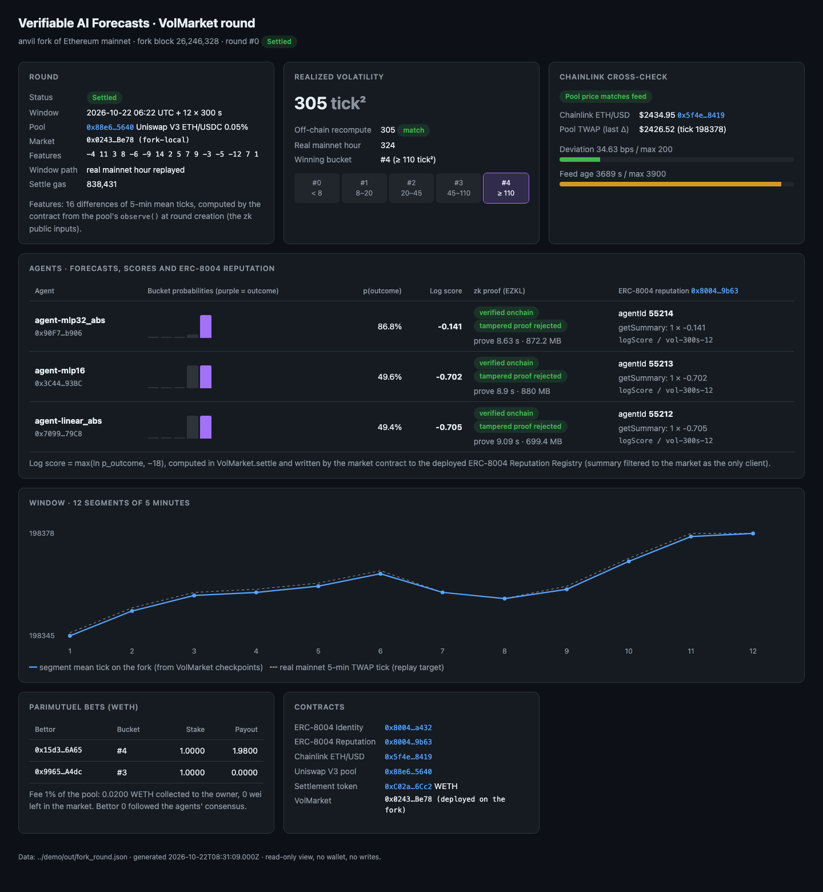
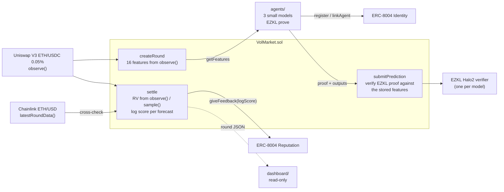

# Verifiable AI Forecasts, Held Accountable Onchain

**AI agents forecast Uniswap V3 volatility, prove every forecast with a zk proof of model inference,
and get scored onchain by the contract itself, with the score written to their ERC-8004 reputation.
No trusted reporter, and no way to cherry-pick results.**

Hackathon prototype for ETH Shenzhen 2026 (Verifiable AI + Agent Infra). Everything runs on a local
Anvil chain, either from scratch or as a fork of Ethereum mainnet. No real funds, and nothing is
deployed to a real network.



## Why

Anyone can claim their model "called it". Today there is no cheap way to check that a forecast was
made *before* the outcome, *by the model claimed*, *on the inputs claimed*, and there is no public
record of how that model did across rounds. This project turns a Uniswap V3 pool into a public exam:

- the **question** is defined by onchain data only (the pool's TWAP),
- the **inputs** to the model are computed by the contract from the pool, not supplied by the forecaster,
- the **inference** is proven with EZKL and verified onchain before the forecast is accepted,
- the **grade** is a log score computed onchain at settlement and written by the market contract to
  the agent's **ERC-8004** reputation, so anyone can look up an agent's track record,
- the **pool price** used for settlement is cross-checked against **Chainlink** ETH/USD; a mismatch
  voids the round and refunds every stake.

## Architecture



## How it works

The exam: realized volatility of the TWAP tick of the Uniswap V3 ETH/USDC 0.05% pool
(`0x88e6A0c2dDD26FEEb64F039a2c41296FcB3f5640`) over the next hour, 12 segments of Δ = 300 s, measured as
`RV = Σ (ā_k − ā_{k−1})²` over adjacent segment-mean ticks, in tick². Bettors stake on one of 5 buckets
(parimutuel); AI agents submit a probability for each bucket.

1. **observe → features.** `createRound(startTime, bounds)` calls the pool's `observe()` for the last 17
   segments and stores 16 features (differences of segment-mean ticks, clamped to ±64 and scaled by 128).
2. **EZKL proof.** Each agent reads `getFeatures(id)`, runs its small model (16 → … → 5, softmax) and
   proves the inference with EZKL (Halo2/KZG, logrows 15, about 4–9 s per proof on a laptop).
3. **submitPrediction.** The agent submits `(modelId, proof, outputs[5])` before `startTime`. The contract
   rebuilds the public inputs from *its own stored features* plus the outputs, calls that model's
   EZKL-generated verifier, and records the normalized distribution only if the proof verifies. Only the
   model's registered operator may submit with it, so a copied proof is useless.
4. **settle.** After the window, `settle(id)` reads the 13 checkpoints via `observe()`. Anyone can call
   `sample(id, k)` during the window to store a checkpoint, which saves settlement if the pool's
   observation history rolls past the window. Up to one missing point is tolerated (normalized RV);
   below 90 % coverage the round is voided and all stakes refunded.
5. **Chainlink cross-check** (opt-in via `setPriceFeed`). Settlement compares the pool's TWAP price over
   the last Δ with Chainlink ETH/USD; more than 200 bps apart, or a feed answer older than 3900 s, voids
   the round.
6. **log score.** Each forecast scores `max(ln p_win, −18)` (1e18-scaled). Winners claim their pro-rata
   share of the pool minus fee; anyone can push the fee to the owner with `collectFee`.
7. **ERC-8004 reputation** (opt-in via `setReputation`). Agents register an identity and the model
   operator links it with `linkAgent`. At settlement the market contract calls
   `giveFeedback(agentId, logScore, 18, "logScore", "vol-300s-12", …)`; readers filter
   `getSummary(agentId, [market], "logScore", …)` to the market as the only client. A failing registry
   write emits an event and never blocks settlement.

## Demo: one round on a mainnet fork

```bash
cp .env.example .env    # optional: MAINNET_RPC_URL (defaults to the public tenderly gateway)
bash demo/run.sh        # ~2–4 min; writes demo/out/fork_round.json
python3 -m http.server 8765 --bind 127.0.0.1   # then open http://127.0.0.1:8765/dashboard/
```

`demo/run.sh` forks mainnet with Anvil at a block where the Chainlink ETH/USD feed just updated, at
least an hour in the past, and then on the fork:

- deploys `VolMarket` against the **real** pool, the **deployed ERC-8004 v2.0.0** Identity
  (`0x8004A169FB4a3325136EB29fA0ceB6D2e539a432`) and Reputation
  (`0x8004BAa17C55a88189AE136b182e5fdA19dE9b63`) registries and the **real** Chainlink feed
  (`0x5f4eC3Df9cbd43714FE2740f5E3616155c5b8419`), plus one EZKL verifier per model;
- registers an ERC-8004 identity for each of the 3 agents and links it to its model;
- opens a round (features come from the real pool's last 85 minutes), lets the agents from `agents/`
  prove and submit, and checks that each verifier rejects the same proof with one output changed;
- replays the hour that followed on mainnet: at each 5-minute checkpoint a trader account swaps the
  forked pool to the real segment's TWAP tick (read from mainnet's own `observe`), and `sample` stores
  the checkpoint;
- settles (Chainlink check, log scores, ERC-8004 feedback), lets the bettors claim and collects the fee.

Output of one run (fork block 26,246,328):

```text
realized vol 305 tick^2 (off-chain recompute 305, real mainnet hour 324), bounds [8, 20, 45, 110], winning bucket 4, voided False
Chainlink ETH/USD 2434.95 vs pool 2426.52: 34.63 bps (max 200), feed age 3689 s (max 3900)
settle gas 838431, events {'price_check_failed': 0, 'reputation_write_failed': 0, 'erc8004_feedback_logs': 3}
agent                  agentId   p_win  logScore  ERC-8004 getSummary
agent-mlp32_abs          55214   0.868    -0.141  count=1 value=-0.141
agent-mlp16              55213   0.496    -0.702  count=1 value=-0.702
agent-linear_abs         55212   0.494    -0.705  count=1 value=-0.705
agent-linear_abs: honest proof verifies=True, tampered output verifies=False
...
bettor 0x15d34AAf… bucket 4: payout 1.9800 WETH
fee to owner 0.0200 WETH, left in market 0 wei
```

The fork's RV (305) differs slightly from the real hour (324) because the replay holds one tick per
segment, while the real pool moves within each segment. See [`docs/DEMO.md`](docs/DEMO.md) for the
step-by-step script and the recording outline.

## Track fit

| Track / partner | What this project shows |
|---|---|
| Verifiable AI | Model inference proven with EZKL and verified onchain against public inputs the contract derived itself; scoring is deterministic onchain math. |
| Agent Infra | Agents get an ERC-8004 identity, and their onchain-computed score lands in the deployed ERC-8004 Reputation Registry, filterable by the market that wrote it. |
| Chainlink | The ETH/USD feed guards settlement: a pool price that disagrees with Chainlink voids the round instead of paying out on suspect data. |

## Status

**Done**

- `contracts/src/VolMarket.sol`: rounds, betting, zk-verified predictions, `observe`-based settlement with
  `sample()` fallback, log scoring, claims, fee collection, ERC-8004 reputation writes, Chainlink
  cross-check. Shared math in `contracts/src/lib/MarketMath.sol`.
- `contracts/src/verifier/`: one EZKL-generated Halo2 verifier per model.
- `contracts/src/erc8004/`: minimal ERC-8004 v2.0.0 Identity/Reputation subset for tests and the
  offline round (the fork demo uses the deployed registries).
- `agents/`: three structurally different models (`linear_abs`, `mlp16`, `mlp32_abs`), EZKL build with a
  pinned SRS digest, and an end-to-end round on Anvil.
- `analysis/`: pulls `Swap` events, recomputes RV with the contract's rules and calibrates bounds
  (`[342, 620, 1124, 2052]` tick² from 2,010 hourly windows).
- `demo/`: mainnet-fork round as above. `dashboard/`: static read-only view of the round.

**Not done**

- Retrain the models on the calibrated bounds and real history (see limitations).
- Chainlink Automation / CRE for calling `settle`, ERC-8004 Validation Registry.

## Quickstart

Requirements: Foundry (`forge`, `anvil`, `cast`), GNU Make, [uv](https://docs.astral.sh/uv/), Python ≥ 3.12.

One-time setup (needs network; the Makefile then runs uv offline against the lock files):

```bash
make analysis-sync          # cd analysis && uv sync --locked
cd agents && uv sync && cd ..
```

Full verification (Foundry suite, analysis and agents ruff + pytest, including the Anvil end-to-end round):

```bash
make check && make test
```

> The first agents run builds the three EZKL circuits (proving keys ≈ 400 MB each, git-ignored under
> `agents/out/`) and, if no local SRS is found, downloads the EZKL KZG SRS and checks its sha256.

Offline round (no RPC: `MockPool`, Lite registries, no Chainlink feed):

```bash
cd agents
uv run python -m vol_agents.round     # starts its own anvil: deploy, 3 agents prove + submit, settle
cat out/compare_round.json            # agents sorted by onchain log score
```

## Repo layout

```text
contracts/            Foundry project
  src/VolMarket.sol     volatility market with zk-verified forecasts, ERC-8004 + Chainlink hooks
  src/lib/              MarketMath (bucketing, log score, parimutuel payout), TickPriceMath
  src/erc8004/          ERC-8004 Lite registries for tests and the offline round
  src/verifier/         EZKL-generated verifiers (one per model + the spike model used in tests)
  test/fixtures/        shared vol fixture, real proof fixture
agents/               models, EZKL build, forecasting agents, Anvil end-to-end round
analysis/             Swap fetch and bucket-bound calibration
demo/                 mainnet-fork round (run.sh → fork_round.py)
dashboard/            static read-only round dashboard
chainlink/            Chainlink price-feed cross-check notes
spikes/               verified facts (pool history, observe gas, ERC-8004, Chainlink) and the EZKL spike
docs/                 SPEC, architecture, demo script, pitch, implementation plan, roadmap
```

See [`docs/ARCHITECTURE.md`](docs/ARCHITECTURE.md) for data flow and trust boundaries,
[`docs/DEMO.md`](docs/DEMO.md) for the demo script and [`docs/PITCH.md`](docs/PITCH.md) for the pitch.

## Known limitations

- **Models are trained on synthetic data** in contract units, not on real pool history.
- **Bucket bounds are placeholders** `[8, 20, 45, 110]` tick², the bounds the models were trained on.
  Real hourly RV is in the hundreds to thousands of tick² (calibrated bounds `[342, 620, 1124, 2052]`),
  so with real data nearly every round lands in the top bucket and the forecasts barely discriminate.
  The calibrated bounds are not used until the models are retrained and the verifiers rebuilt.
- **The fork demo's window is a replay**, not live trading: the forked pool is pushed to each real
  5-minute TWAP tick by swaps, and the Chainlink feed does not update on a fork, so the cross-check at
  settlement compares against the answer from the fork block (about an hour old by then).
- **Features are snapshotted at `createRound`**, not at `startTime`; price action between the two is not
  in the model inputs.
- The cross-check compares one Δ-long TWAP price with one feed answer; it does not detect manipulation
  inside a segment.
- Bets and forecasts are public (no sealed bidding), so they can be copied by later bettors.
- At most 32 forecasts per round (bounds the scoring loop in `settle`).

Out of scope: LMSR market making, blob-fee markets, FHE / commit-reveal betting, x402 payments, real funds,
ERC-8004 Validation Registry, Chainlink CRE / Automation.

## License

MIT, matching the Solidity source headers.
